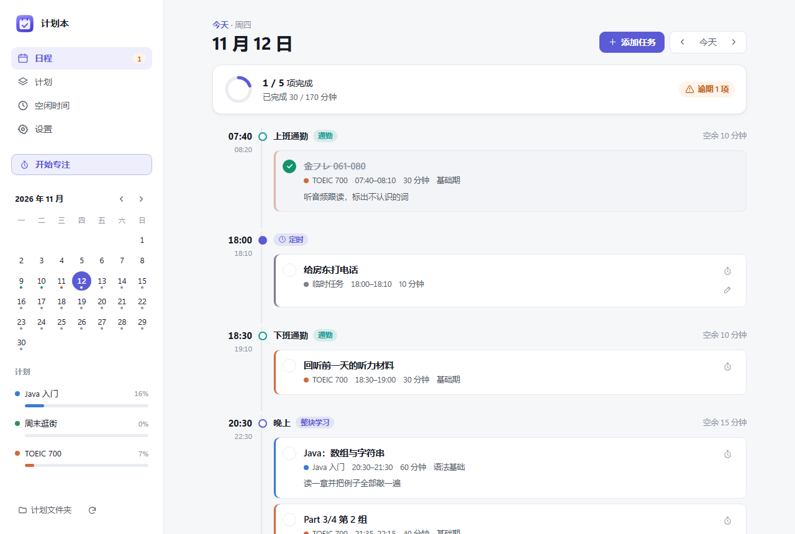
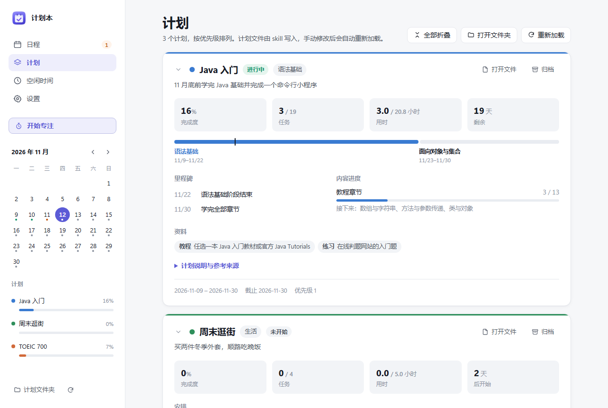
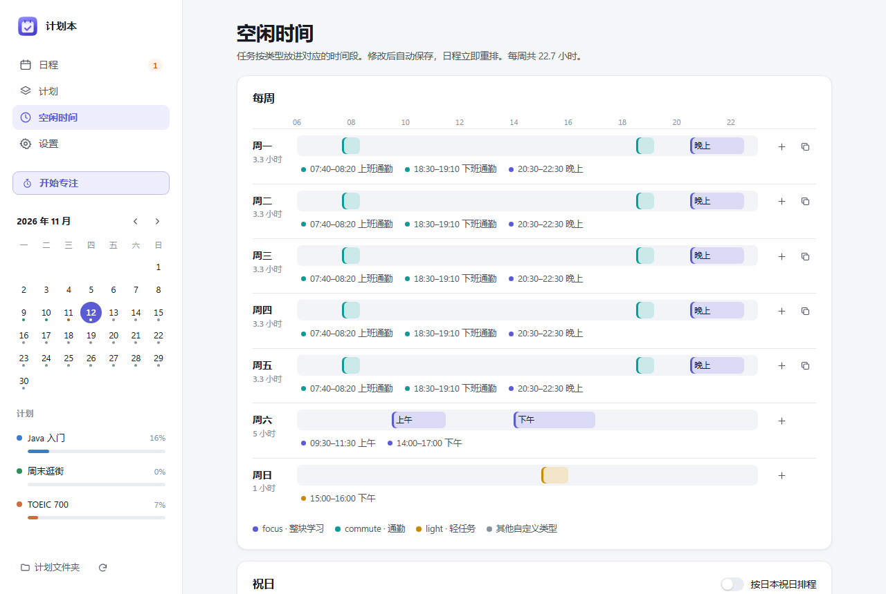

# 计划本（StudyPlanner）

Windows 桌面计划 App。读取 Markdown 格式的计划文件，按每天的空闲时间段排出时间表，记录完成情况，在任务开始前发送 Windows 通知。带番茄钟和托盘菜单。

计划文件由 Claude Code 或 Codex 里的 plan-builder skill 用对话生成，也可以手写。skill 内置在 App 里，在“设置”页一键安装。



## 下载和运行

前置条件：

- Windows 10 或 11
- Microsoft Edge WebView2 运行时（Windows 11 自带）

步骤：

1. 从 [Releases](https://github.com/ryukirin/study-planner/releases/latest) 下载 `StudyPlanner-windows.zip`。
2. 解压到固定的文件夹（例如 `%LOCALAPPDATA%\Programs\StudyPlanner\`）。里面的 `StudyPlanner.exe`（App）和 `planner-cli.exe`（命令行工具，skill 使用）要放在同一个文件夹。不需要安装。
3. 双击 `StudyPlanner.exe`。exe 没有代码签名，第一次运行时 Windows 会提示“Windows 已保护你的电脑”。点“更多信息”，再点“仍要运行”。

运行后的行为：

- 首次运行时，启动文件夹里会创建“计划本”快捷方式，之后登录 Windows 时自动在托盘启动。可以在“设置”里关闭。快捷方式指向 exe 所在位置，移动 exe 后在“设置”里把开机自启关掉再打开一次。
- 每次启动时，把 `planner-cli.exe` 的位置和正在使用的数据目录写入 `%APPDATA%\StudyPlanner\app.json`，skill 和命令行工具按这个文件找到 App 的数据。
- 关闭窗口后 App 缩到托盘继续运行，提醒照常发送。托盘图标的右键菜单里可以查看今天的完成情况和下一项任务、开始番茄钟、暂停任务提醒、跳转到各页面，完全退出要选“退出”。
- 已经在运行时再次双击 exe，会显示已有的窗口。
- 提醒需要打开 Windows 的通知总开关（设置 → 系统 → 通知）。

## 安装 plan-builder skill

需要 Claude Code 或 Codex。

1. 在计划本的“设置”页，找到“plan-builder skill”，点“安装或更新”。skill 复制到 `%USERPROFILE%\.claude\skills\plan-builder`。存在 `%USERPROFILE%\.codex` 时，同时复制到 `.codex\skills\plan-builder`。
2. 重新打开 Claude Code 或 Codex。
3. 直接说需求，例如“这个月学完 Java”“周五 18:00 提醒我给房东打电话”。skill 会反问细节、查资料、生成计划，并用 `planner-cli.exe` 校验和写入，计划本在 5 秒内自动加载。

升级计划本后，再点一次“安装或更新”。skill 文件夹里的 `references\local\` 用来放个人补充说明，安装和更新时不覆盖。

## 界面

计划页：每个计划的完成度、阶段、里程碑和内容进度，卡片可以折叠。



空闲时间页：按星期设置可以排任务的时间段，支持日本祝日和例外日期。



界面、提醒、番茄钟和排程规则的详细说明见 [使用说明.md](使用说明.md)。

## 卸载

1. 在“设置”里关闭开机自启，然后在托盘菜单里选“退出”。
2. 删除解压出来的文件夹。
3. 删除 skill：`%USERPROFILE%\.claude\skills\plan-builder`，装过 Codex 版的还有 `%USERPROFILE%\.codex\skills\plan-builder`。
4. 不再需要计划和完成记录时，删除数据目录 `%APPDATA%\StudyPlanner\`。

## 计划文件

计划文件是 Markdown，正文写给人看，排程用的数据放在 `study-plan` 代码块里（JSON）。示例：

| 文件 | 内容 |
| --- | --- |
| `examples/toeic-700-sample.md` | 长期计划：阶段、每周模板、内容序列、模考 |
| `examples/java-basics-sample.md` | 长期计划：编程学习 |
| `examples/weekend-shopping-sample.md` | 短期计划：只有定时安排 |
| `examples/profile-sample.json` | 空闲时间 |

把计划文件放进数据目录的 `plans\` 文件夹，App 在 5 秒内自动加载。完整的字段说明在 [skills/plan-builder/references/plan-schema.md](skills/plan-builder/references/plan-schema.md)。

## 数据目录

默认为 `%APPDATA%\StudyPlanner\`，可以用环境变量 `STUDY_PLANNER_HOME` 改到别的位置。

| 路径 | 内容 |
| --- | --- |
| `profile.json` | 空闲时间 |
| `plans\*.md` | 计划文件 |
| `tasks.json` | 临时任务 |
| `settings.json` | 设置 |
| `progress.json` | 完成记录和番茄钟记录 |

`app.json` 固定放在 `%APPDATA%\StudyPlanner\`，记录最近一次启动的计划本使用的数据目录和命令行工具。

## 命令行工具

```bat
planner-cli paths
planner-cli check
planner-cli check 草稿1.md 草稿2.md
planner-cli status
planner-cli add-task --title "给房东打电话" --date 2026-11-13 --time 18:00 --minutes 10
```

从源码运行时把 `planner-cli` 换成 `python planner_cli.py`。

- `paths` 显示数据目录和各文件的位置。数据目录按 `--home` 参数 > 环境变量 `STUDY_PLANNER_HOME` > `app.json` 记录的数据目录 > `%APPDATA%\StudyPlanner` 的顺序决定。
- `check` 校验空闲时间和全部计划，输出可行性、未排入的任务、定时任务重叠和时间表预览，并核对计划说明里的阶段表和阶段数据是否一致。可以一次传入多份草稿，按全部加入后的状态检查。返回码 0 表示没有错误。
- 全局参数 `--home <数据目录>` 和 `--today YYYY-MM-DD` 写在子命令前面，例如 `planner-cli --home D:\test-data check`。

## 从源码运行

需要 Python 3.11。在仓库根目录运行：

```bat
python -m pip install -r requirements.txt
python planner_app.py
```

加 `--background` 参数时只在托盘启动，不显示窗口。命令行工具只用标准库，不安装依赖也能运行 `python planner_cli.py`。

修改 skill 时，可以把仓库的 `skills\plan-builder` 用目录联接放进 skills 目录，改动立即生效。设置页的“安装或更新”不覆盖已经是链接的位置。

```powershell
New-Item -ItemType Directory -Force "$env:USERPROFILE\.claude\skills" | Out-Null
New-Item -ItemType Junction -Path "$env:USERPROFILE\.claude\skills\plan-builder" -Target "$PWD\skills\plan-builder"
```

打包：

```bat
build_exe.bat
```

生成 `dist\StudyPlanner.exe`、`dist\planner-cli.exe` 和包含这两个文件的 `dist\StudyPlanner-windows.zip`。脚本最后会等待按键。

测试：

```bat
python -m unittest discover -s tests -t .
```

## 已知限制

- 只支持 Windows。
- App 退出后不发送提醒。
- App 内没有对话功能，生成和调整计划要在 Claude Code 或 Codex 里进行。
