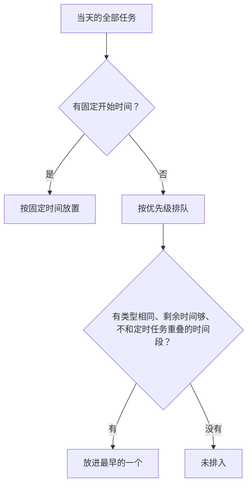
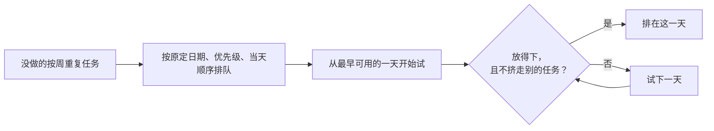

# 计划本的功能细节和排程规则

这里记录各项功能的完整规则，供需要了解细节时查阅。日常使用见 [使用说明](../使用说明.md)。

- [一天的时间表怎么排](#一天的时间表怎么排)
- [日程页](#日程页)
- [调整任务](#调整任务)
- [里程碑和计划页](#里程碑和计划页)
- [空闲时间](#空闲时间)
- [提醒和番茄钟](#提醒和番茄钟)
- [关闭窗口和更新](#关闭窗口和更新)
- [数据文件](#数据文件)

## 一天的时间表怎么排

**当天用哪组空闲时间段**，按以下顺序取第一个符合的：

| 顺序 | 条件 | 使用的时间段 |
| --- | --- | --- |
| 1 | 这一天设了例外日期 | 例外日期的时间段 |
| 2 | 周一至周五的日本祝日，且打开了“按日本祝日排程” | 祝日时间段，默认和周六相同 |
| 3 | 其他日子 | 当天星期的时间段 |

**排队顺序**

1. 手动拖动过的任务，按拖动后的顺序。
2. 计划优先级，数字越小越先。临时任务最先。
3. 同一计划里，原定日期早的先。
4. 计划里当天的顺序。

**其他规则**

- 同一时间段里相邻的两个任务之间，留出“任务之间的间隔”设定的分钟数。
- 一个任务不拆开放进两个时间段。
- 任务按“计划 id + 原定日期 + 模板位置”识别。修改计划的文字不影响完成记录。

## 日程页

| 要做的事 | 操作 |
| --- | --- |
| 标记完成 | 点任务左侧的圆形按钮 |
| 查看详情 | 点任务卡片的其他位置 |
| 打开地点或链接 | 点卡片上的地点或链接，地点在浏览器里打开地图搜索 |
| 调整顺序 | 按住任务左边缘的手柄拖动，见 [可用的调整](#可用的调整) |
| 切换日期 | 左右方向键，或右上角的箭头 |
| 回到今天 | T 键，或右上角的“今天” |
| 补勾逾期任务 | 查看今天时，页面下方列出逾期未完成的任务 |

**三种视图**

| 视图 | 显示方式 | 方向键 |
| --- | --- | --- |
| 日 | 任务按空闲时间段分组。定时任务落在某个时间段里时并入该段，标“定时” | 按天翻 |
| 周 | 一天一列，按开始时间排列，可以直接勾选 | 按周翻 |
| 月 | 月历，每天最多 4 行，其余折叠为“还有 N 项” | 按月翻 |

周视图和月视图里点日期进入那一天的单日视图。拖动只在单日视图里可用。

## 调整任务

所有调整都按排程规则计算，不经过 skill，不修改计划文件，结果记录在 `day_order.json`。

### 可用的调整

| 操作 | 在哪里 | 结果 |
| --- | --- | --- |
| 拖动 | 单日视图 | 改变当天的顺序或所在时间段，开始时间重新计算 |
| 完成并重排 | 今天任务的详情 | 标为完成，今天没做的任务从当前时间起重排 |
| 排到明天 | 任务详情 | 改到后一天。逾期任务显示为“排到今天” |
| 移回 月/日 | 改期过的任务的详情 | 回到原定日期 |
| 全部重排 | 日程页右上角 | 重新安排所有没做的任务的日期 |
| 恢复自动 | 页面顶部的提示 | 清除这一天的拖动顺序和重排时刻，改期不受影响 |

**各类任务参与哪些调整**

| 任务种类 | 拖动 | 排到明天 | 提前完成时前移 | 全部重排 |
| --- | --- | --- | --- | --- |
| 计划里按周重复的任务 | 可以 | 可以 | 会 | 参与 |
| 定时任务 | 不可以 | 可以，开始时间不变 | 不会 | 不参与 |
| 计划里的单次任务 | 可以 | 可以 | 不会 | 不参与 |
| 临时任务 | 可以 | 可以 | 不会 | 不参与 |

### 拖动

- 目标时间段放不下，或会把别的任务挤出原来的时间段时，任务不移动，并提示原因。
- 拖动中按 Esc 取消。
- 拖动只影响这一天。

### 完成并重排

记下点击时的时间，作为重排时刻。

- 没做完的定时任务不动。
- 已完成的任务不再占后面的时间，定时任务也一样。提前完成的任务按实际完成的时间显示。
- 没做的任务按原来的先后顺序，从重排时刻起放进时间段。
- 重排时刻之前已经结束的时间段标“已过去”，不再放任务。
- 放不下的任务进入“未排入”，并写明原因。
- 页面顶部显示“已从 HH:MM 起重排 · 恢复自动”。

“排到明天”“移回”涉及今天时，今天同样从点击时的时间起重排。

### 排到明天

- 任务排在后一天同一计划的任务之前。
- 卡片上标“原定 月/日”。
- 不改变任务的完成记录。

### 提前完成以后的任务

在任务日期之前勾选完成时，那一天自动空出这项任务的时间，任务列在那一天下方的“已提前完成”里。

是计划里按周重复的任务时，同一项重复任务（同一阶段、周模板里的同一个位置）后面没做的各项各前移一格。例如在 11/10 勾选了 11/12 的“精读”：

| 精读原来的日期 | 勾选后 |
| --- | --- |
| 11/12 | 已提前完成，11/12 空出这项的时间 |
| 11/13 | 移到 11/12 |
| 11/16 | 移到 11/13 |
| …… | 依次前移一格 |
| 11/20（最后一次） | 移到 11/19，11/20 空出 |

- 取消完成时，前移的任务移回原来的日期。
- 前移之后又改过日期或已经完成的任务，取消时不动。
- 当天勾选完成不改变当天的时间，也不前移以后的任务。要让今天剩下的任务往前挪，用“完成并重排”。

### 全部重排

| 选项 | 最早可以排到 |
| --- | --- |
| 勾选“把之后的任务提前” | 今天，且不早于所在阶段的开始日期 |
| 不勾选 | 今天，且不早于任务现在的日期 |

- 最晚排到最后一个任务之后 28 天。找不到日期的任务留在原定日期。
- 同一个内容序列的任务保持先后顺序。
- 今天从点击时的时间起排。
- 对话框里的“全部移回原定日期”取消所有改期。
- 计划的阶段范围、里程碑原定日期和截止日期来自计划文件，不随重排改变。落后较多时，让 skill 按进度调整计划。

## 里程碑和计划页

### 里程碑跟随哪些任务

只看原定日期不晚于里程碑、按周重复的任务，再按以下顺序判断：

1. 计划文件里的里程碑写了 `tasks` 时，任务标题包含其中的词或使用其中的序列就跟随。
2. 没写 `tasks` 时，任务标题的开头（第一个花括号或冒号之前）或所用序列的标题出现在里程碑文字里就跟随。例如“面接原稿 35 问写完”跟随“面接原稿：{q}”，不跟随“练手投递”。
3. 一项都没有时，跟随全部按周重复的任务。

鼠标移到计划页的里程碑上，显示跟随的任务。

### 里程碑的日期

每项跟随的任务按以下日期计算：已完成的取完成的那天，没做的取现在排的日期，逾期的取今天。

| 状态 | 里程碑显示的日期 | 标记 |
| --- | --- | --- |
| 跟随的任务全部完成 | 最后一项完成的那天 | 已达成 |
| 还有没做的 | 原定日期 + 最晚日期比最后一项任务的原定日期多出的天数 | 日期变化时标“原定 月/日” |
| 没有可以跟随的任务 | 原定日期 | 无 |

### 计划页

- 每张卡片显示类别、完成度、阶段、里程碑、内容进度、资料和计划说明。
- 阶段条显示各阶段任务现在的起止日期。底部显示改期的项数和最后一项没做的任务的日期。
- 点卡片标题折叠或展开，折叠状态在重启后保留。
- 计划文件有错误时，卡片显示出错的字段。

| 操作 | 结果 |
| --- | --- |
| 归档 | 计划文件移到 `plans\archive\`，不再出现在日程里，完成记录保留 |
| 恢复 | 在计划页底部的“已归档”里，回到日程 |
| 彻底删除 | 删除计划文件和这个计划的完成记录 |

## 空闲时间

- 修改后自动保存，日程立即重排。
- 例外日期里的时间段都按 focus 类型处理。
- 打开“按日本祝日排程”后，周一至周五的祝日默认用周六的时间段，点“单独设置”另设。周六、周日的祝日仍按当天的星期。
- 日本祝日按现行祝日法计算，包括振替休日和国民の休日，覆盖 2020 到 2099 年。春分日和秋分日按国立天文台的推算公式计算。

| 类型 | 适合的任务 |
| --- | --- |
| focus（整块学习） | 需要集中精力的任务 |
| commute（通勤） | 听、背这类在路上能做的任务 |
| light（轻任务） | 短小的任务 |
| 自定义 | 英文小写，计划里的任务写同样的类型才会放进来 |

## 提醒和番茄钟

| 提醒 | 时间 | 默认 |
| --- | --- | --- |
| 定时任务开始前 | 开始前 10 分钟，任务里单独设置的提醒时间优先 | 开 |
| 每个任务开始时 | 时间表里排定的开始时间 | 开 |
| 当日概览 | 每天 08:00，内容为任务数、总时长和逾期数 | 开 |
| 番茄钟结束 | 专注和休息结束时 | 开 |

以下情况不发送提醒：

- 任务已完成。
- 计划本已退出。
- 电脑睡眠期间错过超过 10 分钟。
- 在托盘菜单里暂停了任务提醒（番茄钟提醒不受影响）。
- Windows 的通知总开关关闭。这时“设置”页的提醒栏显示提示和“打开通知设置”按钮。

| 番茄钟 | 默认 |
| --- | --- |
| 专注 | 25 分钟 |
| 短休息 | 5 分钟 |
| 长休息 | 15 分钟，每 4 次专注后一次 |

- 侧栏的“开始专注”不关联任务。任务卡片右侧的计时按钮关联这个任务。
- 专注结束后自动进入休息，休息结束后提醒，下一轮手动开始。
- 完成的专注次数显示在当天概览和任务卡片上，中途放弃的不计入。

## 关闭窗口和更新

**点关闭按钮时**

| 设置 | 结果 |
| --- | --- |
| 每次询问（默认） | 弹窗选择“最小化到托盘”或“退出”。选过后改为所选的方式，不再询问 |
| 最小化到托盘 | 窗口隐藏，提醒和番茄钟照常运行 |
| 退出 | 完全关闭 |

旧版本关掉了“关闭窗口时缩到托盘”的，升级后按“退出”处理。

**更新**

1. “检查更新”读取 GitHub Releases 上最新的正式版。
2. “下载更新”把安装包下载到数据目录的 `updates\`，核对文件大小和 sha256。
3. “重启并更新”把旧的 exe 改名为 `*.exe.old`，放入新的 exe，启动新版本后删除旧文件。

- “自动检查更新”打开时，启动 15 秒后检查一次，有新版本时侧栏的“设置”旁显示圆点。
- 更新后 skill 显示“可更新”，在 plan-builder skill 一栏点“安装或更新”。

## 数据文件

数据目录为 `%APPDATA%\StudyPlanner\`。

| 文件 | 内容 |
| --- | --- |
| `plans\*.md` | 计划文件，一个计划一个文件 |
| `plans\archive\` | 归档的计划 |
| `profile.json` | 空闲时间 |
| `tasks.json` | 临时任务 |
| `progress.json` | 完成记录和番茄钟记录 |
| `day_order.json` | 拖动顺序、重排时刻、改期和前移记录 |
| `settings.json` | 设置 |
| `app.json` | 最近一次启动使用的数据目录、命令行工具和版本 |

- 写入时先写临时文件再替换，上一版保留为 `.bak`。
- 文件无法读取时改名为 `<文件名>.corrupt-时间戳` 保留，并使用默认值。
- 计划被 skill 重新生成后，任务对不上的手动调整自动失效。
