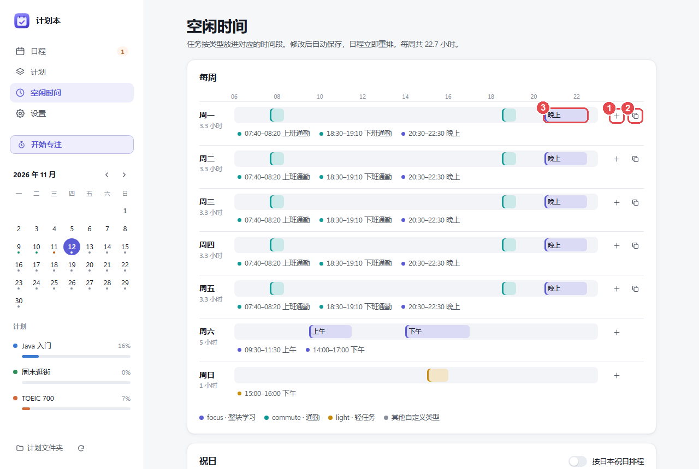
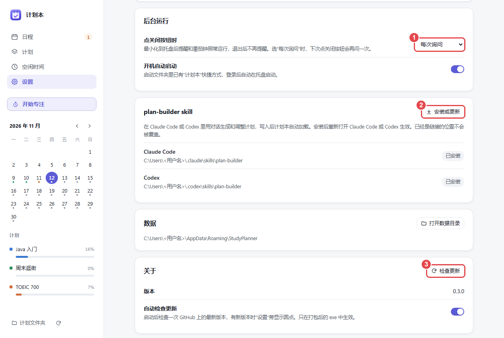
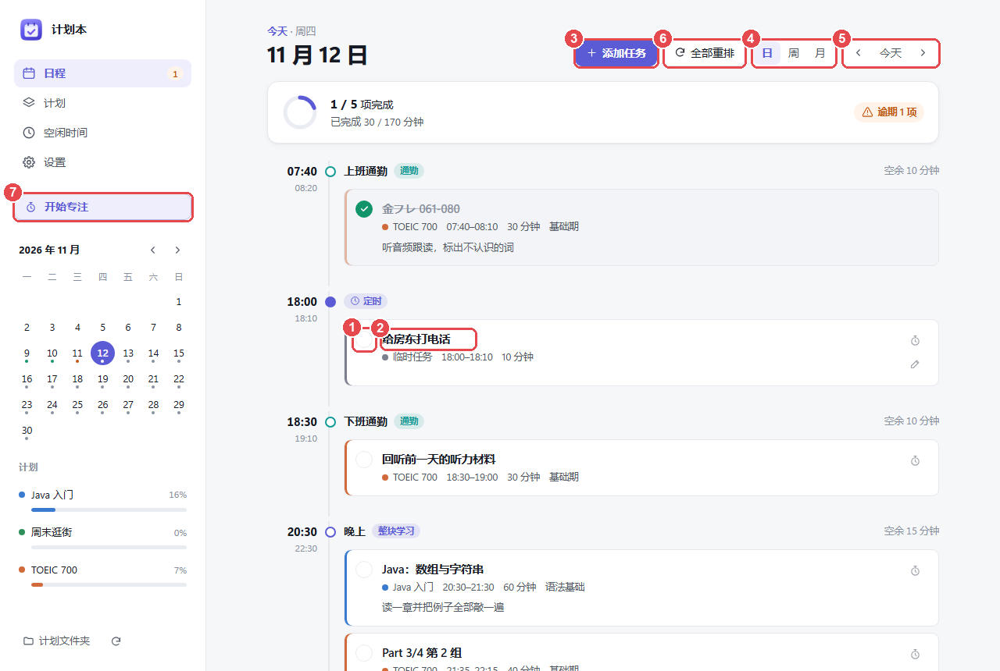
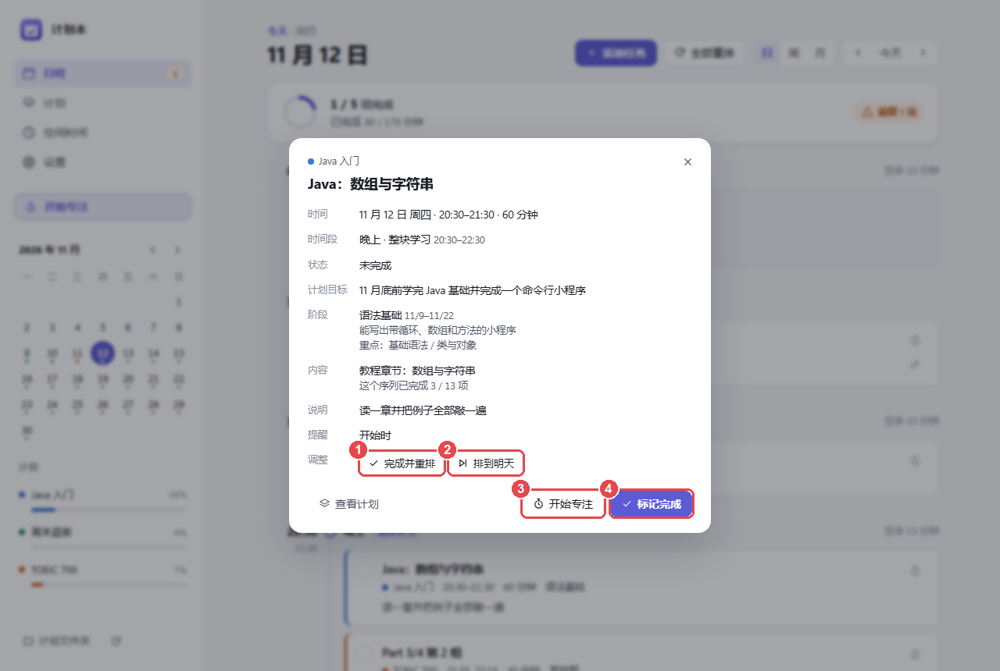
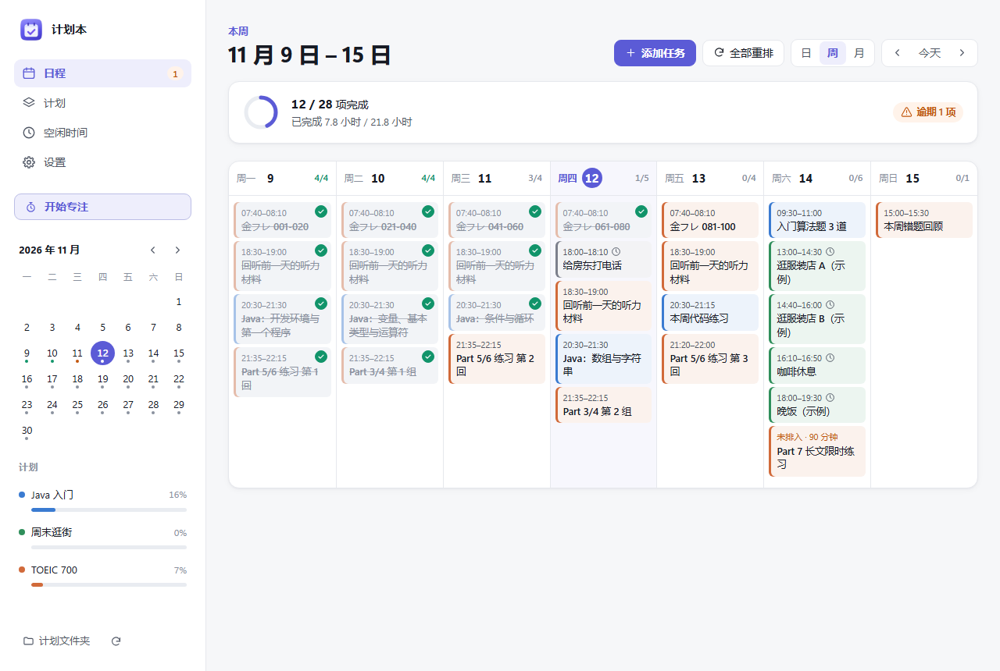
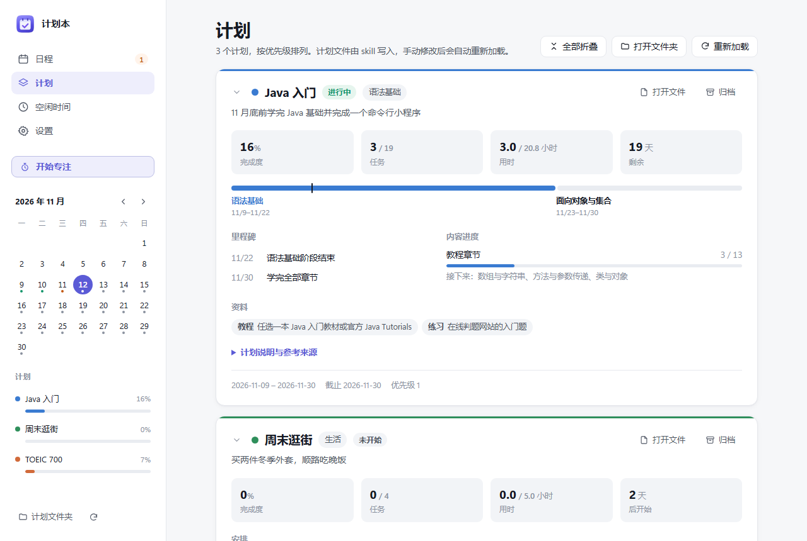
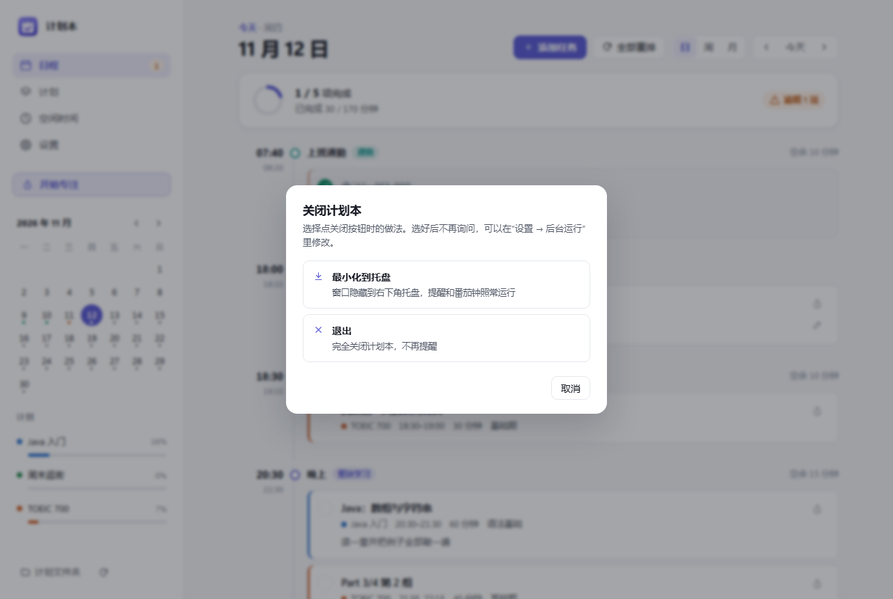

# 计划本使用说明

计划本按每天的空闲时间排出要做的事，到点提醒，做完打勾。计划由 plan-builder skill 通过对话生成，Claude Code、Codex 等支持 skill 的 AI 编程工具都可以使用。

第一次使用按下面四步来。

## 准备：下载和打开

1. 在 [Releases 页面](https://github.com/ryukirin/study-planner/releases/latest) 下载 `StudyPlanner-windows.zip`。
2. 解压到一个固定的文件夹。里面的两个文件要放在一起。
3. 双击 `StudyPlanner.exe`。

出现“Windows 已保护你的电脑”时，点“更多信息”，再点“仍要运行”。

打开后，屏幕右下角的托盘里出现计划本的图标。以后开机自动启动。

## 第一步：设置什么时候有空

在左侧点“空闲时间”。

1. 点 **+**，填开始时间、结束时间和类型，添加一段空闲时间。
2. 工作日每天都一样时，设好周一后点这个按钮，复制到周一至周五。
3. 点已有的时间段，可以修改或删除。

某天加班或出差时，在本页下方的“例外日期”里单独设置那一天。

## 第二步：安装 plan-builder skill

在左侧点“设置”。

点 **②“安装或更新”**，然后重新打开 AI 编程工具。

“安装或更新”自动安装到 Claude Code，装了 Codex 时也安装到 Codex。使用其他支持 skill 的工具时，把 `%USERPROFILE%\.claude\skills\plan-builder` 文件夹复制到该工具的 skills 目录。

## 第三步：在 AI 编程工具里说出目标

在 Claude Code、Codex 等工具里直接说想做的事，例如：

- “这个月学完 Java 基础”
- “今年拿到 TOEIC 700”
- “周六想去表参道买衣服，推荐店和吃饭的地方”
- “周五 18:00 提醒我给房东打电话”

skill 会先问几个问题，比如现在的水平、每周能用多少时间。回答完后，计划自动写进计划本，几秒后日程里出现任务。

## 第四步：每天看日程，做完打勾

在左侧点“日程”。

1. 做完的任务，点左边的圆圈打勾。
2. 点任务名，查看详细内容。
3. 临时加一件小事。
4. 切换按日、按周、按月查看。
5. 翻到前一天、后一天，或回到今天。
6. 落下很多任务时，一次重新安排。
7. 开始 25 分钟的专注计时。

任务开始前，屏幕右下角弹出提醒。

## 常用操作

### 来不及做，或提前做完了

点任务名打开详情。

1. **完成并重排**：提前做完了。今天剩下的任务从现在起往前挪。
2. **排到明天**：今天做不完，移到明天。
3. **开始专注**：开始一轮专注计时。
4. **标记完成**：和点圆圈打勾一样。

### 调整顺序

把鼠标放到任务上，左边出现手柄。按住手柄拖到别的位置或别的时间段。

### 按周查看

### 查看计划进度

在左侧点“计划”。

### 关闭窗口

第一次点窗口右上角的关闭按钮时，计划本询问关闭方式。

- **最小化到托盘**：窗口收起，提醒照常。
- **退出**：完全关闭，不再提醒。

选过一次后不再询问。要修改时，在“设置”页的 **①“点关闭按钮时”** 里选择。

在托盘图标上点右键，可以打勾、开始专注、暂停提醒或退出。

### 更新到新版本

在“设置”页最下方点 **③“检查更新”**。有新版本时点“下载更新”，下载完点“重启并更新”。

更新后，在“设置”页再点一次“安装或更新”，skill 也换成新版本。

## 遇到问题

| 现象 | 处理 |
| --- | --- |
| 收不到提醒 | 在“设置”页点“发送测试通知”。仍然收不到时，打开 Windows 的“设置 → 系统 → 通知”，把通知打开 |
| 任务出现在“未排入” | 当天空闲时间不够。任务下方写着原因，按原因添加时间段，或把任务排到明天 |
| 时间段显示“已过去” | 那段时间已经过去，没做的任务排到了后面。要放回去时，点页面上方的“恢复自动” |
| 关掉窗口后找不到计划本 | 计划本在屏幕右下角的托盘里，点图标显示窗口 |
| 检查更新失败 | 在浏览器打开 [Releases 页面](https://github.com/ryukirin/study-planner/releases/latest)，下载新的 zip，替换原来的两个文件 |
| 移动文件夹后不再开机启动 | 在“设置”里把“开机自动启动”关掉再打开 |

## 数据保存在哪

计划和完成记录保存在 `%APPDATA%\StudyPlanner\`。在“设置”页点“打开数据目录”可以直接打开。

换电脑时，先在托盘菜单里选“退出”，再把这个文件夹整个复制到新电脑的同一位置。

各项功能的详细规则见 [功能细节和排程规则](docs/排程规则.md)。
